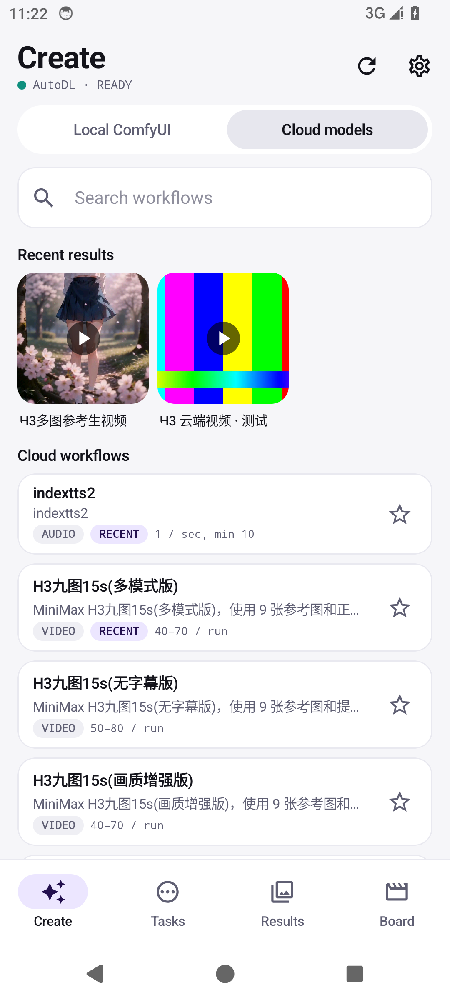
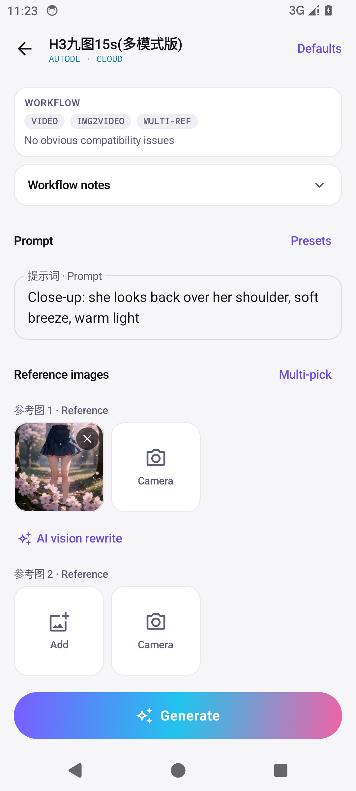
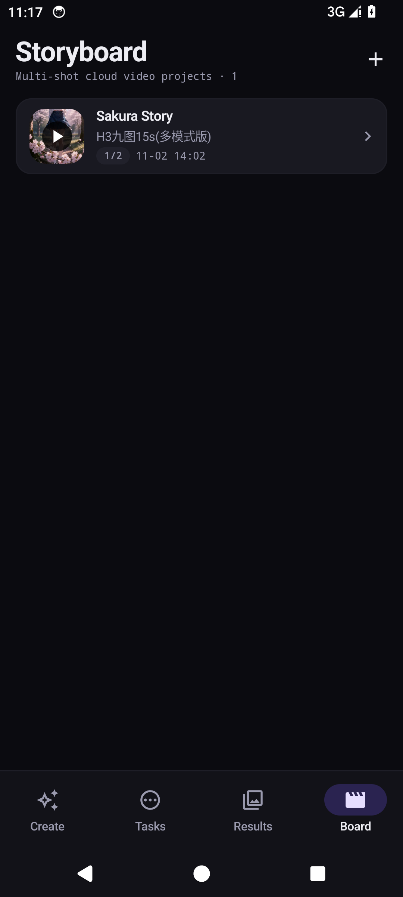
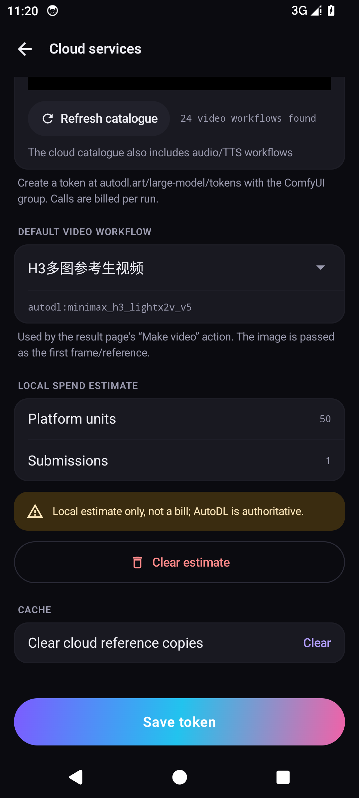

# Iris · 灵瞳

[中文](#中文) | [English](#english)

[](https://github.com/Starysoor/Iris/releases)
[](https://github.com/Starysoor/Iris/actions/workflows/test.yml)

One lens, every model. Android client for local ComfyUI **and** hosted cloud workflows — pick a model, write a prompt, generate images, video or audio.

**v2.3.2** · [Download APK](https://github.com/Starysoor/Iris/releases/latest) · [Cloud provider guide](docs/CloudProviders.md) · [AutoDL guide](docs/AutoDL.md) · [Screenshots](docs/verification)

<a href="docs/verification/redesign/light-create.png"></a>
<a href="docs/verification/redesign/light-generate.png"></a>
<a href="docs/verification/redesign/dark-board.png"></a>
<a href="docs/verification/redesign/dark-cloud-settings.png"></a>

## English

**Iris** turns your phone into a remote for generation models running on your PC or in the cloud:

- **Local + multi-provider cloud workflows** — browse local ComfyUI and AutoDL.Art workflows alongside OpenAI, Gemini, Replicate, SiliconFlow, AutoDL Models and configurable OpenAI-compatible / JSON-template APIs
- **Cloud workspace** — provider cards group every model by vendor; model lists are pulled from each provider (never hard-coded), and a provider can be hidden without deleting its settings
- **Workflow conversion** — converts ComfyUI canvas JSON to API format automatically and discovers prompts, seeds, reference images and advanced parameters
- **Cloud video + audio** — image-to-video, first/last-frame, multi-image/multi-audio, lip-sync and TTS workflows; results are downloaded immediately because hosted URLs expire
- **Cost guardrails** — platform price, per-run estimate and confirmation before a paid submit; local spend estimate and cancel warnings
- **Storyboard** — build multi-shot cloud video projects with reusable project assets. Tail-frame relay is an optional per-project mode; returned frames are added to project assets and Results automatically
- **Vision-aware AI** — the built-in “AI vision rewrite” actually sends your image to a multimodal model, then rewrites the prompt around what it sees
- **AI prompt skills** — expand / tag / translate / negative / vision skills via any OpenAI-compatible endpoint (DeepSeek, Zhipu, OpenAI, Qwen, Moonshot, Ollama); custom skills and per-workflow bindings
- **Live progress** — foreground service, node-level progress, latent preview, cancel, task recovery after process death, local batch queue
- **History** — full prompts + seeds, image/video/audio thumbnails and playback, one-tap reuse, A/B comparison for images, image → video handoff
- **Multi-server** — saved servers, LAN discovery, health/queue probing, least-busy switching
- **Configurable UI** — compact layout, recent-result count, theme, default batch/seed/queue, upload size and more in Settings
- **Iris design system** — purpose-built light/dark palettes, typography, surfaces, chips, inputs and edge-to-edge navigation
- **Secret storage** — tokens normally use Android Keystore-backed AES/GCM; when Keystore encryption is unavailable, a legacy plaintext fallback can be used to prevent token loss

## 中文

**Iris（灵瞳）**把手机变成生成模型的遥控器：本地 ComfyUI 与云端工作流，一个入口完成。

### 核心能力

- **本地 + 多厂商云端**：创作页统一管理本地 ComfyUI、AutoDL.Art 托管工作流，以及 OpenAI、Gemini、Replicate、SiliconFlow、AutoDL Models 和可自定义的兼容接口、JSON 模板 API
- **云服务工作台**：按厂商分组展示模型，模型列表由厂商接口拉取而不是内置预设；可随时关闭某个厂商而不删除配置
- **云端视频 + 音频**：图生视频、首尾帧、多图参考、多图多音频、对口型与 TTS；云端结果是临时链接，成功后立即下载到手机
- **费用护栏**：提交前显示平台计价、本次预估并二次确认；本地记录预估消耗；取消云端任务会提示平台侧可能继续计费
- **分镜**：把多个云端视频镜头串成项目，支持复用项目素材；尾帧接力是可选的整项目玩法，返回的尾帧会自动进入项目素材和结果库
- **真正看图改写的 AI**：内置「AI 看图改写」会把参考图作为图片输入发给多模态模型，再结合你的修改要求重写提示词；不是纯文本猜测
- **AI 提示词技能**：扩写、标签、翻译、负面、看图改写等，兼容任意 OpenAI 风格接口（DeepSeek、智谱、OpenAI、Qwen、Moonshot、Ollama），支持自定义技能与按工作流绑定
- **实时反馈**：前台服务保活、节点进度、latent 预览、取消、进程重启恢复、本地批量队列
- **结果库**：完整提示词 + 实际 seed、图片/视频/音频缩略图与播放、一键复用、图片 A/B 对比、图片一键转云端视频
- **多服务器**：保存地址、局域网发现、健康/队列探测、最空闲切换
- **可定制界面**：紧凑布局、最近结果数量、主题、默认批量/种子/队列、上传尺寸等，全部集中在设置页
- **Iris 设计系统**：自建浅色/深色配色、字体、卡片、Chip、输入框和 edge-to-edge 导航
- **密钥保护**：正常设备使用 Android Keystore 的 AES/GCM 加密保存令牌；Keystore 不可用时为避免丢失令牌，可能回退到本地明文保存，建议在安全设备上使用

### 连接方式

Iris 现支持 Tailscale 设备发现：普通局域网和 VPN 网段搜索无需额外凭据；如需发现从未保存的其他 Tailnet 节点，可以在连接页或服务器管理页配置只读 `devices:core:read` Tailscale API 访问令牌。详见 [Tailscale 设备发现指南](docs/TAILSCALE_DISCOVERY.md)。

| 场景 | 地址 |
|---|---|
| 模拟器 | `http://10.0.2.2:8188` |
| 手机与电脑同一 Wi-Fi | `http://<电脑局域网IP>:8188` |
| 任意网络 | 电脑与手机都装 [Tailscale](https://tailscale.com)，填电脑的 Tailscale IP |
| 云端（无需本地显卡） | 设置 → 云端服务，选择对应厂商并配置其独立 API Key / Endpoint；AutoDL 托管工作流使用 ComfyUI 分组 Token |

ComfyUI 需以 `--listen 0.0.0.0` 启动。连接页可直接选择“仅使用云端模型”。

### 云端计费与恢复提醒

云端 Provider 根据其各自的计费规则收费。Iris 会在发起付费生成前显示实际厂商、可获得的价格/预估并请求确认；本地“预估消耗”不是厂商账单。取消本地跟踪不一定会取消远端任务，某些厂商仍可能继续执行及计费。云端结果链接可能过期，请及时保存。

v2.3.0 增强了云端任务状态和结果的重启恢复；极端情况下，如果远端已接受任务而本机持久化同时失败，仍可能需要手工找回远端任务 ID。详见 [云服务配置与恢复说明](docs/CloudProviders.md)。

## Build

```bash
# Requires JDK 17+ and an Android SDK (compileSdk 34) + Gradle 8.7 wrapper
./gradlew :app:assembleDebug          # debug APK
./gradlew :app:testDebugUnitTest      # converter + generation + cloud/storyboard tests
./gradlew :app:lintDebug              # Android lint
```

On Windows PowerShell use `.\gradlew.bat`. If your Windows user profile path contains non-ASCII characters, set an ASCII `GRADLE_USER_HOME` so Gradle test workers can launch.

Release builds are produced by GitHub Actions on `v*` tags (signing key provided via repo secrets).
`tools/ai_mock.mjs` runs a local mock OpenAI server for keyless testing of the AI expansion flow.
`tools/fetch_fixtures.mjs` refreshes the real ComfyUI workflow fixtures.

> The technical package name (`com.comfyremote.app`) is intentionally retained after the Iris rebrand so existing installs can still receive in-app updates. Change `applicationId` only when you are ready for a clean install.

### Documentation

- [Cloud services: providers, configuration, recovery and known limits](docs/CloudProviders.md)
- [AutoDL cloud workflows, parameters and billing](docs/AutoDL.md)
- [Iris Studio project model and migration notes](docs/PROJECT_MODEL.md)
- [Iris Studio QA / emulator and phone acceptance checklist](docs/STUDIO_QA.md)
- [v2.3.2 release notes](docs/releases/v2.3.2.md)
- [v2.3.0 release notes](docs/releases/v2.3.0.md)
- [Verification screenshots](docs/verification)
- [v2.2 redesign screenshots](docs/verification/redesign)
- [Changelog](CHANGELOG.md)

The repository was renamed from `Starysoor/ComfyRemote` to `Starysoor/Iris`; GitHub redirects old URLs, and the in-app updater points at the new repository.

## License

[MIT](LICENSE)
