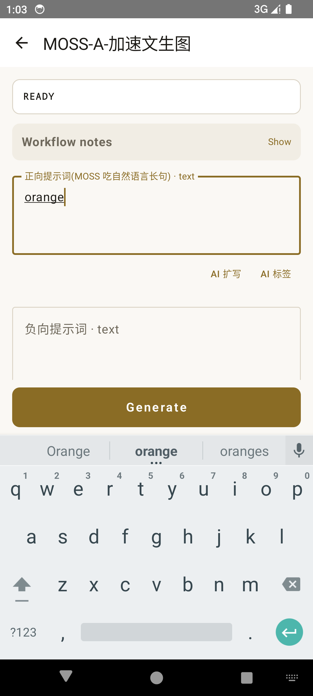
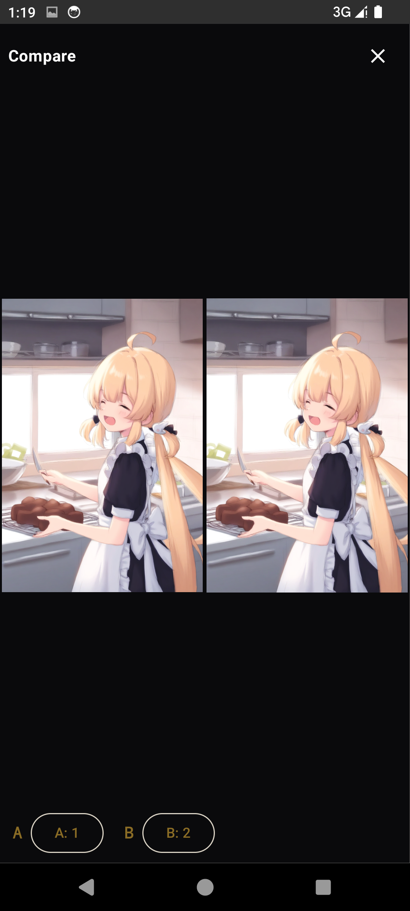

# ComfyRemote

[中文](#中文) | [English](#english)

Android remote client for your PC's ComfyUI: pick a workflow, type a prompt, generate — no canvas needed.

<a href="docs/screen-generate.png"></a>
<a href="docs/screen-results.png"></a>
<a href="docs/screen-compare.png"></a>

## <a id="english"></a>English

**ComfyRemote** turns your phone into a remote for a ComfyUI server running on your PC:

- **Workflow picker** — lists every workflow saved in ComfyUI and converts the canvas JSON to the API format automatically; you only edit the prompts
- **Smart fields** — discovers prompt boxes, seeds, reference images and advanced params (steps/CFG/sampler/LoRA strength…) from the workflow; workflow author notes are shown too
- **AI prompt expansion** — "AI expand" (natural language, MOSS/Qwen style) and "AI tag" (Danbooru tags, SDXL/Anima style) buttons via any OpenAI-compatible API (DeepSeek/Zhipu/OpenAI/local Ollama); skills are fully customizable, plus temperature / max tokens / thinking mode / extra JSON
- **Live progress** — foreground service keeps generation alive in background; node + progress on screen, in the notification, and a live latent preview; cancel anytime (status shows "Cancelled", not an error)
- **History** — every run is stored locally with full prompts + seeds, thumbnails, one-tap re-generate, A/B result comparison
- **Auto-update** — the app checks GitHub Releases and updates itself (no token needed, the repo is public)
- **img2img** — album multi-select, camera, or **share an image straight from your gallery** into the reference slot; large photos are auto-downscaled for fast upload
- **Bilingual UI** (Chinese/English, follows system) and light/dark themes

## <a id="中文"></a>中文

安卓手机遥控电脑 ComfyUI：选工作流 → 填提示词 → 出图，全程无需碰电脑画布。

### 连接方式

| 场景 | 地址 |
|---|---|
| 模拟器 | `http://10.0.2.2:8188` |
| 手机与电脑同一 Wi-Fi | `http://<电脑局域网IP>:8188` |
| 任意网络（推荐） | 电脑与手机都装 [Tailscale](https://tailscale.com)，填电脑的 Tailscale IP，如 `http://100.x.x.x:8188` |

ComfyUI 需以 `--listen 0.0.0.0` 启动；连接页支持多服务器别名（长按 chip 重命名/删除）。

### 功能

- **工作流列表**：自动拉取 ComfyUI 保存的全部工作流（UI 格式画布 JSON → API 格式）
- **智能字段识别**：提示词、种子、参考图片、高级参数（步数/CFG/采样器/LoRA 强度…）；工作流内 MarkdownNote 说明会折叠展示
- **AI 提示词扩写**：内置「AI 扩写」（自然语言，MOSS/Qwen 风格）与「AI 标签」（Danbooru 标签）技能，可编辑、可新增任意技能；按钮按工作流类型自动排序；支持温度/最大输出 tokens/思考模式/附加 JSON 参数
- **实时反馈**：前台服务保活（锁屏不中断），通知栏实时节点与百分比（点击跳回 App），latent 实时预览，随时取消（状态正确显示"已取消"而非报错）
- **本地历史**：完整提示词 + 实际种子落盘，缩略图、一键按原参数重新生成、结果 A/B 并排对比
- **应用内自动更新**：检查 GitHub Releases → 下载 → 安装，无需 token（公开仓库）
- **图生图**：相册多选 / 拍照 / **系统分享直接进 App 填入参考图**；大图自动压缩到 1536px 加速上传
- **双语界面** + 浅色/深色主题跟随系统

### 常见问题（Troubleshooting）

| 现象 | 处理 |
|---|---|
| 连接失败 `failed to connect` | ComfyUI 启动参数需加 `--listen 0.0.0.0`；确认地址和端口；确认手机与电脑在同一网络（或 Tailscale 已连接） |
| 能连上但生成排队不动 | 电脑上可能有其他任务在跑；界面和通知栏显示队列数量 |
| 手机连不上、电脑能连 | Windows 防火墙放行 8188 入站（建议限定局域网/Tailscale 网段） |
| 提示"未知节点 xxx 已跳过" | 工作流用到了未安装的自定义节点，在电脑上装齐后刷新 |
| 更新下载失败 | 用"复制下载链接"在浏览器下载后手动安装 |

## Build

```bash
# Requires JDK 17+ and an Android SDK (compileSdk 34)
gradle :app:assembleDebug          # debug APK
gradle :app:testDebugUnitTest      # converter unit tests (real workflow fixtures)
```

Release builds are produced by GitHub Actions on `v*` tags (signing key provided via repo secrets).
`tools/ai_mock.mjs` runs a local mock OpenAI server for keyless testing of the AI expansion flow.

## License

[MIT](LICENSE)
